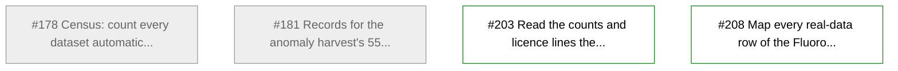
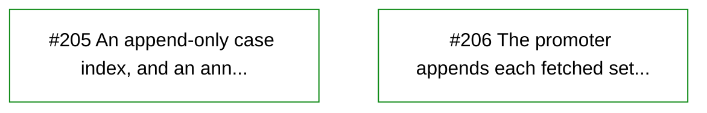

# Board

As of commit 3a5a2b6 on main. Rewritten by .github/workflows/board.yml; do not edit by hand.

## Claims (open claude/<issue> branches and docs/agents/claims/<issue>.md)

| Issue | Branch | Worker | PR | Files it touches |
| --- | --- | --- | --- | --- |
| (not a claim) | claude/project-thread-tn9lgv | no claim file yet | (no pull request yet) | - |

## Open pull requests

| PR | Title | Branch | State (clean, behind, conflicting, blocked, unknown) | Last update |
| --- | --- | --- | --- | --- |
| (none) |  |  |  |  |

## Overlaps (files that more than one piece of open work changes; land the work in this order: a blocker first, then work marked ready, then the oldest)

| File | Open work, in the order it should land |
| --- | --- |
| (none) |  |

## Queue (open issues labelled todo, unclaimed and given to no worker)

| Issue | Title | Labels |
| --- | --- | --- |
| #7 | Obtain MAGIC-CT (Zenodo) | needs-owner, todo |
| #8 | Obtain cm_spine: one Google Drive file described only as 'intraoperative' (empty download) | todo |
| #9 | Obtain MrOS lateral spine radiographs (Osteoporotic Fractures in Men) (blocked by #251) | todo |
| #10 | Obtain SOF lateral spine radiographs (Study of Osteoporotic Fractures) (blocked by #251) | todo |
| #11 | Obtain ReXGradient-160K (Rajpurkar lab and Gradient Health, 2025) | todo |
| #12 | Obtain PadChest (BIMCV, Alicante) | todo |
| #13 | Obtain CheXpert and CheXpert Plus (Stanford AIMI) | todo |
| #17 | Obtain VinDr-PCXR (PhysioNet) | granted, todo |
| #23 | Obtain Kaggle scoliosis YOLOv5 annotated spine X-ray set (salmankey) | needs-owner, todo |
| #24 | Obtain Kaggle bone fracture multi-region X-ray data (bmadushanirodrigo) | todo |
| #25 | Obtain Aariz cephalometric benchmark (Khalid, Fraz 2023) and the ISBI 2015 cephalograms | todo |
| #26 | Obtain KUB-StoneX (Daffodil International University HIRL) | todo |
| #28 | Obtain VertXNet extra labels for NHANES II (Mo, Papiez, Chen 2023) | todo |
| #30 | Obtain PENGWIN 2024 Task 2 synthetic X-rays | todo |
| #32 | Obtain Veterinary: canine lateral thoracic radiographs for vertebral heart size (Mendeley ktx4cj55pn) | todo |
| #33 | Obtain Mendeley DDH hip sets (jf3pv98m9g and 4gvcb6gmh2) | todo |
| #36 | Obtain FracAtlas (Abedeen 2023, Scientific Data) | todo |
| #37 | Obtain NIH ChestX-ray14 and the RSNA pneumonia subset | todo |
| #38 | Obtain Coronary angiography sets (CADICA, ARCADE, XCAD, AngioCAD) | todo |
| #43 | Obtain Neurosurgical Focus: Video (every article CC BY 4.0) | todo |
| #44 | Obtain STOIC2021 public release (AWS Open Data) | todo |
| #45 | Obtain IDC `cptac_lscc` (tier 2) | todo |
| #46 | Obtain IDC `cptac_luad` (tier 2) | todo |
| #47 | Obtain IDC `ldct_and_projection_data` (tier 2) | todo |
| #48 | Obtain IDC `lidc_idri` (tier 2) | todo |
| #49 | Obtain IDC `midrc_ricord_1b` (tier 2) | todo |
| #50 | Obtain IDC `nsclc_radiogenomics` (tier 2) | todo |
| #51 | Obtain IDC `nsclc_radiomics` (tier 2) | todo |
| #52 | Obtain IDC `prostate_anatomical_edge_cases` (tier 2) | todo |
| #53 | Obtain IDC `spinal_multiple_myeloma_seg` (tier 2) | todo |
| #54 | Obtain IDC `spine_mets_ct_seg` (tier 2) | todo |
| #85 | Obtain CT-RATE chest CT | granted, todo |
| #86 | Obtain CADS CT (unique cases) | granted, todo |
| #87 | Obtain RSNA abdominal trauma CT (RATIC) | granted, todo |
| #90 | Obtain ENHANCE.PET 1.6k: whole-/total-body FDG-PET/CT, 1,683 studies (NIfTI) | todo |
| #91 | Obtain NLST, full (tier 2; 500-person pilot fetched) | todo |
| #92 | Obtain COBRA2026 embargoed cases | todo |
| #110 | Obtain BRAX Brazilian chest films (PhysioNet) | needs-owner, todo |
| #111 | Obtain BIMCV COVID-19+ chest films (IEEE DataPort) | needs-owner, todo |
| #170 | Obtain the IPCAI 2025 language digital twin cadaver set (Killeen 2025, Google Drive, 845 MB) | todo |
| #171 | Obtain FluoroSeg (Killeen 2025, Hugging Face, gated; CC BY-NC-SA 4.0 per its code repository, card to confirm): 2.95 million synthetic X-rays with masks, text and poses from 1,621 CTs | granted, todo |
| #182 | Obtain the Loop-X lower-torso cadaver frames of Zenodo 10390295 (Killeen, Unberath et al., JHU ARCADE), or show they are #170's cadaver | paired, todo |
| #183 | Obtain the interventional XA frames of TCIA's CMB-MML and CMB-AML collections, with the same patients' CT | paired, todo |
| #184 | Obtain the CMB-MML skeletal-survey radiographs for the patients whose CT is in the same collection | paired, todo |
| #185 | Obtain the COVID-19-NY-SBU films of the patients whose CT is held, the 27 abdominal pairs first | paired, todo |
| #186 | Find the CT localizers of TCIA's CT COLONOGRAPHY and other held CT collections, and fetch those missing | paired, todo |
| #187 | Obtain US-X Complete (TUM CAMP): lumbar phantoms with Loop-X lateral X-rays and co-registered CBCT | paired, todo |
| #188 | Obtain MIDRC Open Data Commons cases with both CT and CR or DX, the spine-labelled studies first | paired, todo |
| #189 | Ask for the UCLA spine radiotherapy setup radiographs with their planning CTs (Charters et al. 2024) | paired, todo |
| #190 | Ask for the ExacTrac spine radiotherapy kV images with planning CTs (Petragallo, Lamb et al. 2023) | paired, todo |
| #191 | Ask for the standing biplanar lumbar radiographs with CT (Yu, Tsai et al., Med Phys 2026) | paired, todo |
| #192 | Ask FAU or Siemens Healthineers for the thoracolumbar CBCT sweeps (Jaganathan, Maier et al.) | paired, todo |
| #193 | Ask the Siewerdsen and Zbijewski groups for their cadaver frames with CT (Otake 2013, Huang 2022) | paired, todo |
| #194 | Ask for the intraoperative spine cases of RadGS-Reg (MICCAI 2025) | paired, todo |
| #195 | Ask BG Klinik Ludwigshafen for the MINTOS cadaver series on three C-arms (Brunken et al. 2026) | todo |
| #196 | Ask the Framingham Heart Study for the CT scouts of its MDCT cohort (low priority) | paired, todo |
| #197 | Ask AGES-Reykjavik for the CT scouts of its cohort (low priority) | paired, todo |
| #198 | Ask for the Spine-DART cadaver frames with their Loop-X CT (Johns Hopkins 2026) | paired, todo |
| #199 | Ask for the UC Davis and Augmedics cadaver screw study's frames with CT (Global Spine J 2025) | paired, todo |
| #200 | Ask Giessen and Jena for the canine biplanar fluoroscopy of the lumbosacral spine with CT (Front Vet Sci 2021) | paired, todo |
| #201 | Ask for SheepSpineX: ovine cervical AP and lateral films with CT (Shanghai Jiao Tong University) | paired, todo |
| #203 | Read the counts and licence lines the census cannot read yet, from the sources' own pages | todo |
| #204 | A landing pass for the held sets: bytes, file counts and SHA256SUMS written into their records | todo |
| #205 | An append-only case index, and an annotation layout beside raw/, for every set on the shared volume | todo |
| #206 | The promoter appends each fetched set's cases to its case index | todo |
| #207 | LUMOS: show whether film n and CT n are the same patient, and write the pair key | todo |
| #208 | Map every real-data row of the Fluoroscopy Data Atlas to a record here, a task, or a stated reason | todo |
| #251 | File the NIA Aging Research Biobank request for the MrOS and SOF spine images (Dr. Schwiebert as Requester/PI) | todo |
| #260 | Obtain CAMS-Knee (ETH Zurich and Charite Berlin, J Biomech 2017) (blocked by 1 open issue) | accounting, todo |
| #273 | Obtain Harms Study Group registries (adolescent idiopathic scoliosis and other pediatric spinal deformity) | accounting, todo |
| #313 | Obtain IEEE DataPort lateral full-spine X-ray dataset (236 films) | accounting, todo |
| #346 | Write the record for the set held in fluorocap | todo |
| #349 | Write the record for the set held in ieee_dataport_lateral_fullspine_236 | todo |
| #351 | Write the record for the set held in mendeley_5jdfdgp762 | todo |
| #360 | Write the record for the set held in spinal_ai2024 | todo |
| #363 | Write the record for the set held in spinesac | todo |
| #368 | Name the 17 GB folder of the data root whose name the readout withholds | todo |

## Given to workers (open issues a worker's label names, not yet claimed)

| Issue | Title | Worker |
| --- | --- | --- |
| (none) |  |  |

## Blockers (open issues labelled blocker)

| Issue | Title | Labels |
| --- | --- | --- |
| (none) |  |  |

## Recently merged (the last 5)

| PR | Title | Branch | Merged |
| --- | --- | --- | --- |
| #371 | Bring in symphony-protocol 0.7.0 | symphony-protocol/sync | 2026-10-31T14:20:46Z |
| #387 | Retire opens a read-only folder of the set before it unlinks | claude/386 | 2026-10-31T04:31:32Z |
| #385 | Storage jobs ask for 64G | claude/384 | 2026-10-31T04:11:50Z |
| #379 | Storage request 20261031T021925Z | storage/request-20261031T021925Z | 2026-10-31T02:56:28Z |
| #383 | Storage apply: plan a request again once a written plan was refused | claude/382 | 2026-10-31T02:52:50Z |

## Dependencies

Each open epic's tasks as GitHub's sub-issues and blocked-by relations hold them: an arrow runs from the issue that blocks to the issue it blocks, dotted once the blocker is closed; a node's shade is its state, and an epic's heading counts its closed tasks.

### Epic #174: Track: plan the annotation of the paired CT and X-ray data (0/22)

```mermaid
flowchart TD
  i170["#170 Obtain the IPCAI 2025 language digita..."]:::todo
  i182["#182 Obtain the Loop-X lower-torso cadaver..."]:::todo
  i183["#183 Obtain the interventional XA frames o..."]:::todo
  i184["#184 Obtain the CMB-MML skeletal-survey ra..."]:::todo
  i185["#185 Obtain the COVID-19-NY-SBU films of t..."]:::todo
  i186["#186 Find the CT localizers of TCIA's CT C..."]:::todo
  i187["#187 Obtain US-X Complete (TUM CAMP): lumb..."]:::todo
  i188["#188 Obtain MIDRC Open Data Commons cases..."]:::todo
  i189["#189 Ask for the UCLA spine radiotherapy s..."]:::todo
  i190["#190 Ask for the ExacTrac spine radiothera..."]:::todo
  i191["#191 Ask for the standing biplanar lumbar..."]:::todo
  i192["#192 Ask FAU or Siemens Healthineers for t..."]:::todo
  i193["#193 Ask the Siewerdsen and Zbijewski grou..."]:::todo
  i194["#194 Ask for the intraoperative spine case..."]:::todo
  i195["#195 Ask BG Klinik Ludwigshafen for the MI..."]:::todo
  i196["#196 Ask the Framingham Heart Study for th..."]:::todo
  i197["#197 Ask AGES-Reykjavik for the CT scouts..."]:::todo
  i198["#198 Ask for the Spine-DART cadaver frames..."]:::todo
  i199["#199 Ask for the UC Davis and Augmedics ca..."]:::todo
  i200["#200 Ask Giessen and Jena for the canine b..."]:::todo
  i201["#201 Ask for SheepSpineX: ovine cervical A..."]:::todo
  i207["#207 LUMOS: show whether film n and CT n a..."]:::todo
  classDef todo fill:#ffffff,stroke:#0e8a16,color:#000000
  classDef claimed fill:#fff8d6,stroke:#fbca04,color:#000000
  classDef review fill:#e3f0ff,stroke:#1d76db,color:#000000
  classDef blocked fill:#ffe7e7,stroke:#e99695,color:#000000
  classDef closed fill:#eeeeee,stroke:#999999,color:#666666
```

### Epic #175: Track: one knowledge synthesis of the datasets, generated from the records (2/4)

### Epic #176: Track: the data workflow from request to a carded, verified set on the grid (1/8)

```mermaid
flowchart TD
  i202["#202 Say held for the 19 records whose fol..."]:::closed
  i204["#204 A landing pass for the held sets: byt..."]:::todo
  i346["#346 Write the record for the set held in..."]:::todo
  i349["#349 Write the record for the set held in..."]:::todo
  i351["#351 Write the record for the set held in..."]:::todo
  i360["#360 Write the record for the set held in..."]:::todo
  i363["#363 Write the record for the set held in..."]:::todo
  i368["#368 Name the 17 GB folder of the data roo..."]:::todo
  classDef todo fill:#ffffff,stroke:#0e8a16,color:#000000
  classDef claimed fill:#fff8d6,stroke:#fbca04,color:#000000
  classDef review fill:#e3f0ff,stroke:#1d76db,color:#000000
  classDef blocked fill:#ffe7e7,stroke:#e99695,color:#000000
  classDef closed fill:#eeeeee,stroke:#999999,color:#666666
```

### Epic #177: Track: workflows whose datasets grow without a restart (0/2)

### Epic #372: Fluoroscopy and C-arm sets: the requests by letter and the clips found online (0/27)

### Epic #373: Spine and skeletal radiographs: open downloads, portal requests and the agreements the owner files (0/16)

```mermaid
flowchart TD
  i9["#9 Obtain MrOS lateral spine radiographs..."]:::todo
  i10["#10 Obtain SOF lateral spine radiographs..."]:::todo
  i14["#14 Obtain TVGH-SpineXR"]
  i23["#23 Obtain Kaggle scoliosis YOLOv5 annota..."]:::todo
  i24["#24 Obtain Kaggle bone fracture multi-reg..."]:::todo
  i25["#25 Obtain Aariz cephalometric benchmark..."]:::todo
  i26["#26 Obtain KUB-StoneX (Daffodil Internati..."]:::todo
  i28["#28 Obtain VertXNet extra labels for NHAN..."]:::todo
  i30["#30 Obtain PENGWIN 2024 Task 2 synthetic..."]:::todo
  i32["#32 Obtain Veterinary: canine lateral tho..."]:::todo
  i33["#33 Obtain Mendeley DDH hip sets (jf3pv98..."]:::todo
  i36["#36 Obtain FracAtlas (Abedeen 2023, Scien..."]:::todo
  i108["#108 Obtain TVGH ankylosing spondylitis ce..."]
  i251["#251 File the NIA Aging Research Biobank r..."]:::todo
  i273["#273 Obtain Harms Study Group registries (..."]:::todo
  i313["#313 Obtain IEEE DataPort lateral full-spi..."]:::todo
  i251 --> i10
  i251 --> i9
  classDef todo fill:#ffffff,stroke:#0e8a16,color:#000000
  classDef claimed fill:#fff8d6,stroke:#fbca04,color:#000000
  classDef review fill:#e3f0ff,stroke:#1d76db,color:#000000
  classDef blocked fill:#ffe7e7,stroke:#e99695,color:#000000
  classDef closed fill:#eeeeee,stroke:#999999,color:#666666
```

### Epic #374: Chest radiograph banks for the screener: the open and the credentialed (0/10)

```mermaid
flowchart TD
  i11["#11 Obtain ReXGradient-160K (Rajpurkar la..."]:::todo
  i12["#12 Obtain PadChest (BIMCV, Alicante)"]:::todo
  i13["#13 Obtain CheXpert and CheXpert Plus (St..."]:::todo
  i15["#15 Obtain MIMIC-CXR and MIMIC-CXR-JPG (P..."]
  i16["#16 Obtain VinDr-CXR (PhysioNet)"]
  i17["#17 Obtain VinDr-PCXR (PhysioNet)"]:::todo
  i35["#35 Obtain Open-i Indiana chest collection"]
  i37["#37 Obtain NIH ChestX-ray14 and the RSNA..."]:::todo
  i110["#110 Obtain BRAX Brazilian chest films (Ph..."]:::todo
  i111["#111 Obtain BIMCV COVID-19+ chest films (I..."]:::todo
  classDef todo fill:#ffffff,stroke:#0e8a16,color:#000000
  classDef claimed fill:#fff8d6,stroke:#fbca04,color:#000000
  classDef review fill:#e3f0ff,stroke:#1d76db,color:#000000
  classDef blocked fill:#ffe7e7,stroke:#e99695,color:#000000
  classDef closed fill:#eeeeee,stroke:#999999,color:#666666
```

### Epic #375: CT collections: open releases, gated requests and the challenge sets (0/25)

